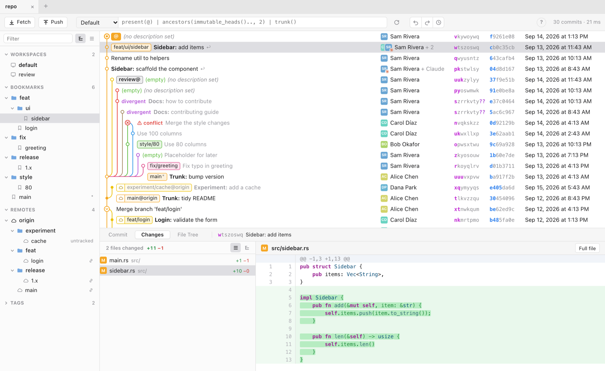
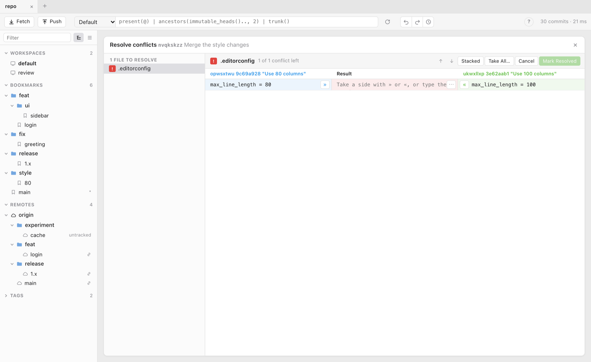
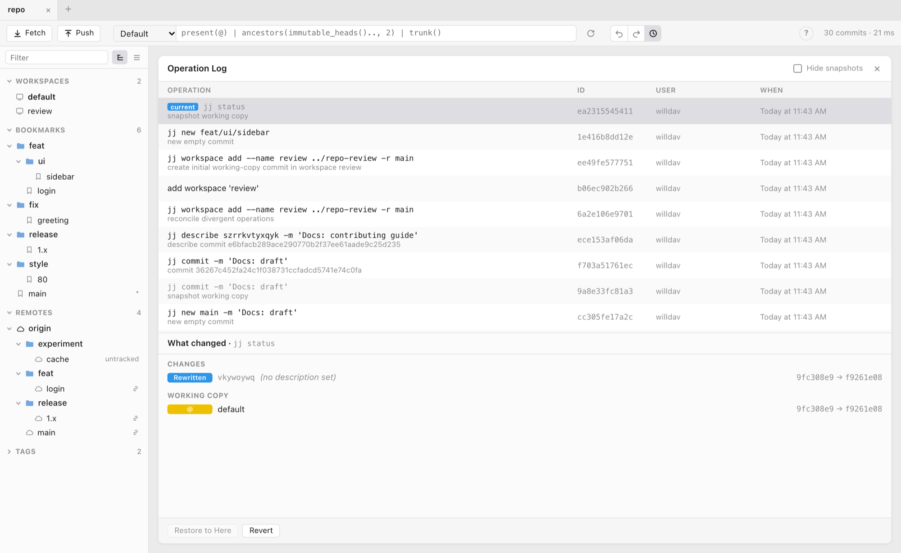

# Jig - GUI for JJ

A desktop GUI for [Jujutsu](https://github.com/jj-vcs/jj), built with Tauri and `jj-lib`.



Inspired by `jjui` and `Fork (git)`.

### Why Jig

For 90% of my `jj` workflows `jjui` is my go to tool. But there are two things that it doesn't do for me:
1. Sometimes when I'm working on multiple workspaces / branches I just need to ***see*** the graph visually and interactively
2. I still suck at resolving conflicts; this tool provides a nice merge gui

While I built this for the 2 reasons above, `jig` also supports most of the other `jj` operations and uses the same keybindings as `jjui`.


## Features

- Commit graph with bookmarks, remotes, workspaces, divergence and conflicts
- Diffs, file tree and commit comparison (⌘-click two commits)
- New, describe, squash, split, rebase, abandon, revert and cherry-pick, with undo/redo
- Fetch, push and bookmark management
- Oplog viewer
- `jjui` key bindings (press `?` for shortcuts)

### Conflict resolver



### Operation log



## Install

Download the `.dmg` from the [latest release](../../releases/latest) and drag Jig to Applications. Jig runs repository changes through your `jj`, so it needs `jj` 0.40 on your `PATH`.

Jig isn't notarized yet, so macOS will refuse to open it the first time. Clear the quarantine flag with:

```bash
xattr -dr com.apple.quarantine /Applications/Jig.app
```

To build from source for other systems, see [DEVELOPMENT.md](DEVELOPMENT.md).
